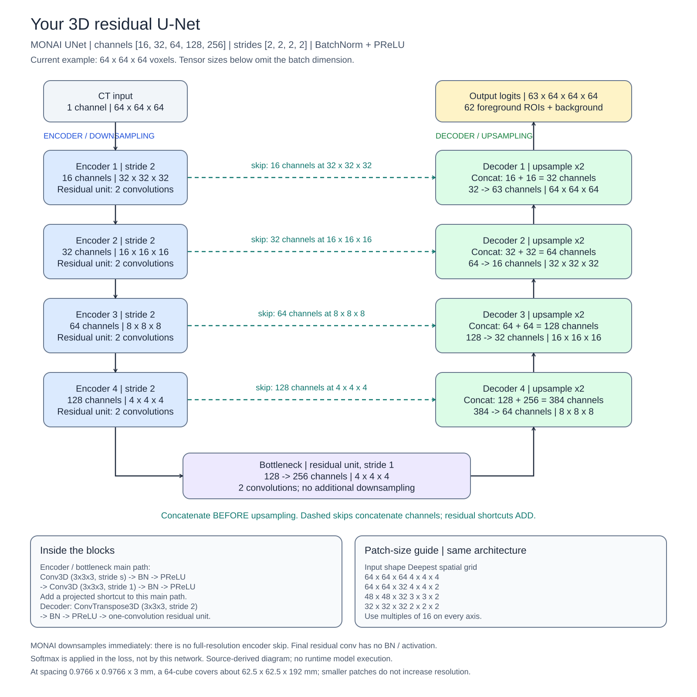
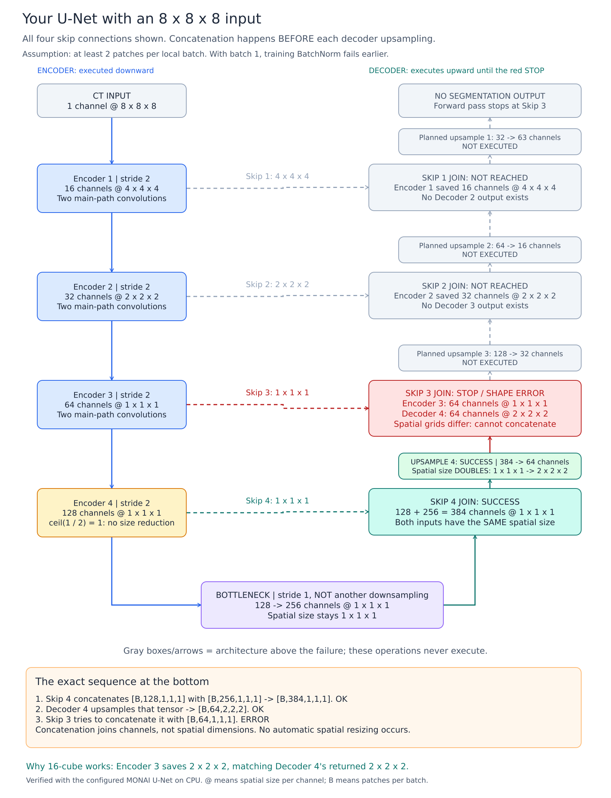
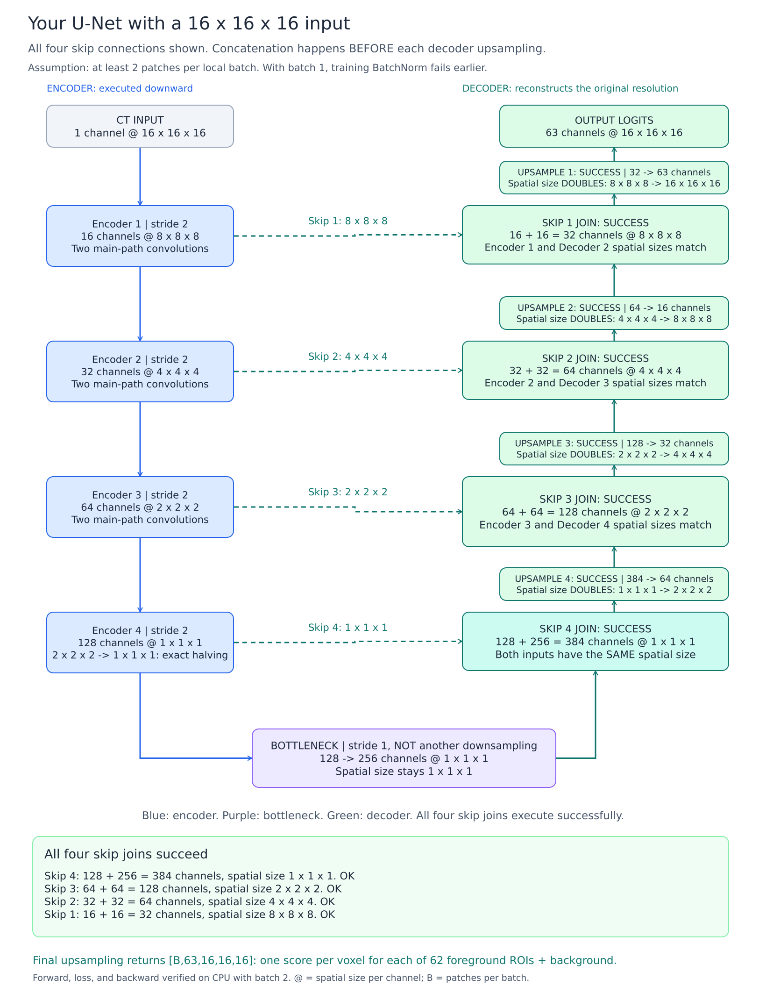
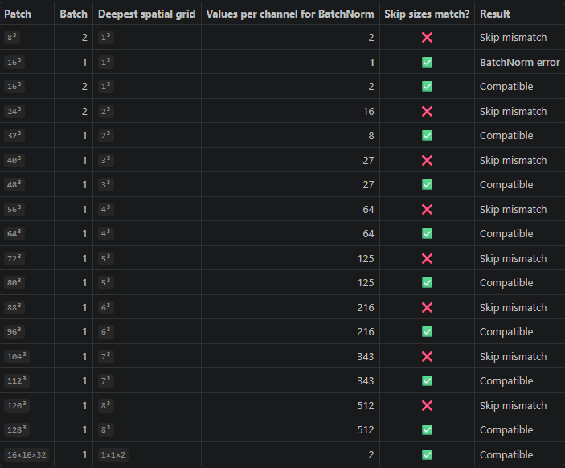

# Our current architecture with a patch_size 64



# Skip connection arguments size mismatch

We have 4 stride-2 stages, so the input is downsampled 4 times by 2: $2^4 = 16$. Therefore each input dimension must be divisible by 16, so that the tensors concatenated via skip connections have the same size.

**Example:** input `8x8x8`

```text
Encoder stage 3:   spatial size 1³ ─────────┐  saved for the skip connection
        │                                   │
        ▼                                   │
Encoder stage 4:   stride 2, size stays 1³  │
        │                                   │
        ▼                                   │
Bottleneck:        1³                       │
        │                                   │
        ▼                                   │
Decoder upsample:  1³ → 2³                  │
        │                                   │
        └──── try to combine 2³ with 1³ ◄───┘  → size mismatch
```



How it looks for a `16x16x16` input:



# BatchNorm needs more than one value per channel

- **`16³` (or smaller) with batch 1:** the deepest spatial map is `1×1×1` (as discussed above), so BatchNorm receives only one value per channel and PyTorch throws an error. With batch size > 1 this does not happen.
- **`32³` with batch 1:** the deepest spatial map is `2×2×2`, so BatchNorm gets 8 values per channel.
- **`16×16×32` with batch 1:** `1 × 1 × 2 = 2` spatial positions.

As a result:



## Conclusion

- Four stride-2 stages: each input axis must be a multiple of 16 for matching input/output dimensions.
- Minimum cubic input: `16x16x16`; training BatchNorm requires local patch batch >= 2.
- BatchNorm constraint: `B * (X/16) * (Y/16) * (Z/16) > 1`. `32^3` and `16x16x32` support batch 1.
- Patch dimensions refer to post-spacing voxels. Ablations: `64^3` -> `64x64x32` -> `48x48x32`, reducing Z then XY context.
- Architectural compatibility does not establish optimal segmentation performance; evaluate ROI retention, Dice, and false positives under fixed validation.